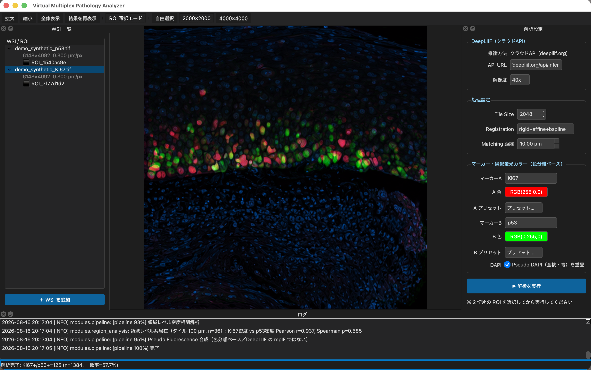
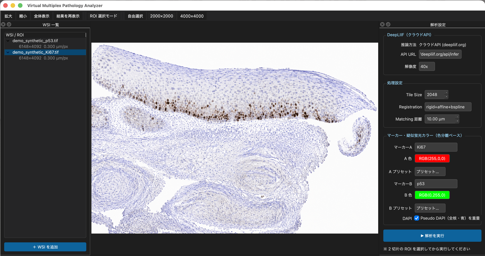
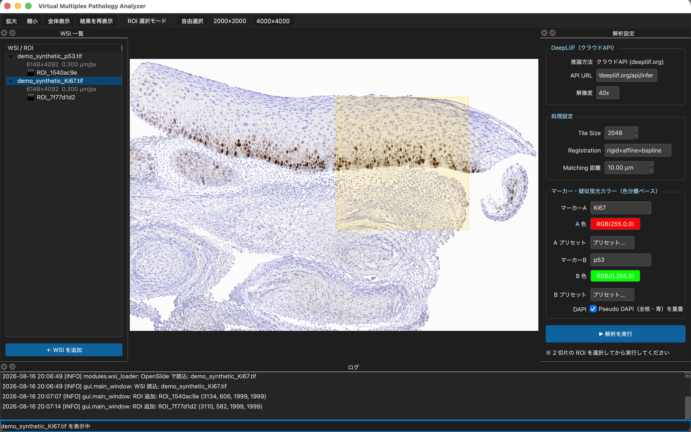
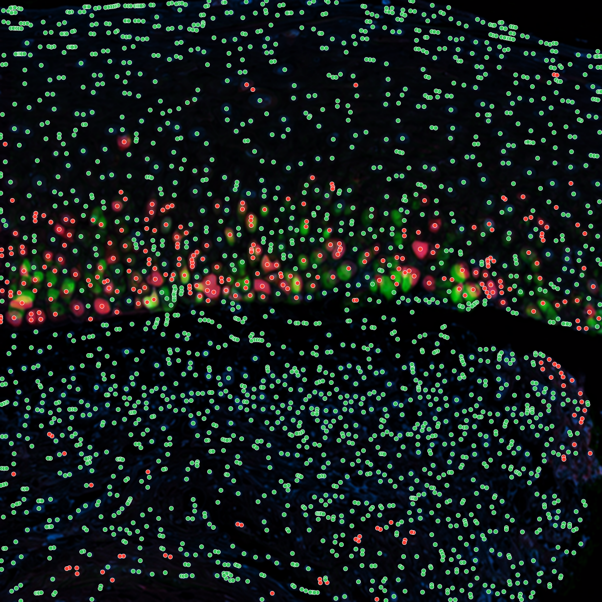
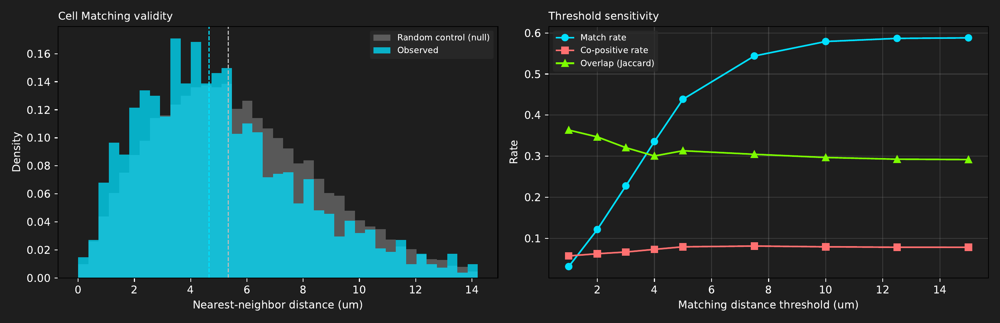
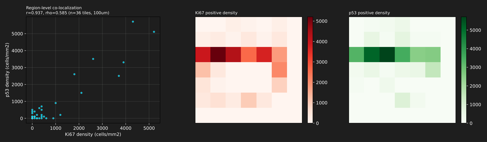
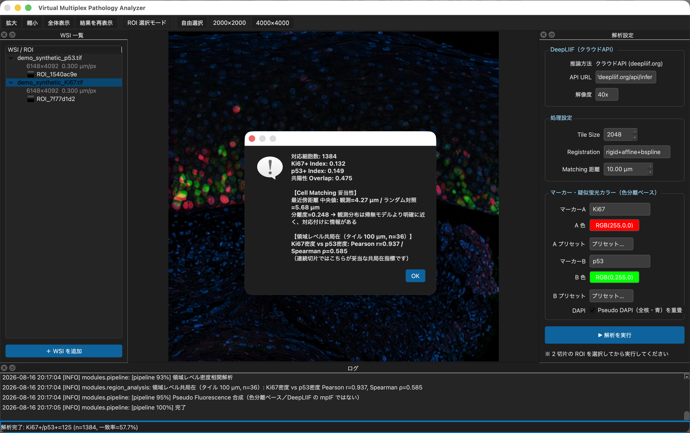

# Virtual Multiplex Pathology Analyzer

A prototype desktop GUI application for **serial-section whole-slide image (WSI)** analysis
in pathology, including virtual multiplex fluorescence-like visualization from immunohistochemistry images. Given two consecutive sections stained for different
markers (e.g. Ki67.ndpi and p53.ndpi), it performs:

1. **Cell detection & positivity** — via the [DeepLIIF](https://deepliif.org)
   cloud API (SegRefined mask).
2. **Non-rigid image registration** — SimpleITK Rigid → Affine → B-spline.
3. **Pseudo-fluorescence visualization** — stain-deconvolution based
   (NOT DeepLIIF-generated multiplex IF).
4. **Cell-level matching + validity check** — nearest-neighbor pairing
   plus a null-model diagnostic (see "Honest limitations" below).
5. **Region-level co-localization** — tile-based Pearson/Spearman
   correlation of positive-cell densities.
6. **Export** — CSV / Excel / PNG / PDF / PPTX / JSON.

Runs on **macOS (Apple Silicon/Intel)** and **Windows 11**. GPU is not
required (the DeepLIIF cloud API handles inference).

> [!IMPORTANT]
> **About the demo images in this README**
>
> Every screenshot and analysis result shown below was produced from
> **AI-generated synthetic pathology images**. No patient specimens or
> clinical images are included anywhere in this repository. The cell
> counts and statistics shown illustrate software behaviour only and do
> **not** represent diagnostic performance.



## ⚠ Important notices

- **Research and education use only. Not for clinical diagnosis.**
- **Non-commercial use only.** This project depends on DeepLIIF, which
  is distributed under Apache 2.0 with the Commons Clause condition.
  This project therefore uses the same license (see `LICENSE`).
- This project is an independent personal software project developed by the author. It is not an official product of the author's employer. Bug reports and issues are handled on a best-effort basis.
- **Do not upload PHI/PII** (patient-identifying whole-slide images) to
  the DeepLIIF public endpoint. Use anonymized or public sample data.

## Honest limitations (please read before publishing results)

Several aspects of this workflow are known to be imperfect and are
surfaced in the output rather than hidden:

- **The DeepLIIF cloud API returns only segmentation outputs**
  (`Seg`, `SegOverlaid`, `SegRefined`) — it does **not** return the
  Virtual DAPI / Marker / Lap2 modality images that DeepLIIF is known
  for. Those require local (GPU) execution of DeepLIIF, which this
  project does not perform. Consequently:
  - Cell detection and positive/negative classification **are** from
    DeepLIIF (SegRefined).
  - The colored "fluorescence-like" display and the "Pseudo DAPI"
    channel are **stain-deconvolution outputs of the original IHC**
    (Ruifrok–Johnston), not DeepLIIF Virtual IF.
- **Serial sections do not preserve 1:1 cell correspondence.** A Ki67
  nucleus and a p53 nucleus that lie a few micrometers apart across
  adjacent sections are typically **different cells**. This project
  therefore always computes a null-model diagnostic (`match_diagnostics`):
  the observed nearest-neighbor distance distribution is compared with
  the distribution under a random-placement null. If the two are not
  distinguishable, the "co-positive rate" is flagged as not being
  evidence of same-cell co-expression.
- **A positive separation score is not proof of cell-level
  correspondence.** The null model places points uniformly at random
  within the ROI. When the ROI contains regions of very different cell
  density — epithelium next to stroma, for example — nearest-neighbor
  distances in the dense region are necessarily shorter than under a
  uniform null, so separation can be positive merely because the two
  sections share a density gradient. Read the threshold-sensitivity plot
  alongside it (see the demo below for a worked example).
- **Region-level co-localization** (tile-based density correlation) is
  the recommended primary readout for serial-section IHC pairs.

## Screenshots

The following walkthrough uses an AI-generated synthetic Ki67 / p53 pair
(see "Sample data" below for how it was produced).

**Analysis settings used:** DeepLIIF cloud API at 40x, ROI 2000 × 2000 px
(600 × 600 µm) placed at the same coordinates on both sections,
registration `rigid+affine+bspline`, matching distance 10.00 µm.

### 1. Main window



Four-pane layout: WSI list (left), viewer (center), analysis settings
(right), log (bottom). Dimensions and mpp of each loaded slide are shown
in the list.

*Input is an AI-generated synthetic image, not patient data.*

### 2. ROI selection



Click to place a fixed-size ROI using the `2000×2000` preset, with a
cursor-following preview. Place the ROI at the **same coordinates** on
both sections — otherwise registration ends up correcting your click
error rather than the actual tissue deformation, and the overlapping
area shrinks.

*Input is an AI-generated synthetic image, not patient data.*

### 3. Pseudo-fluorescence merge


Ki67 (red) and p53 (green) overlaid on a hematoxylin-derived Pseudo DAPI
channel (blue). The band of positive nuclei along the basal layer
contrasts with the negative stroma below.

As noted above, this display is stain-deconvolution based — it is not
DeepLIIF Virtual IF.

*Input is an AI-generated synthetic image, not patient data.*

### 4. Cell detection overlay



Individual nuclei obtained by watershed splitting of the DeepLIIF
`SegRefined` mask, colored by positivity (red = positive,
green = negative). A density heatmap is produced alongside it.

*Input is an AI-generated synthetic image, not patient data.*

### 5. Cell matching validity



| Metric | Value |
|---|---|
| Matched cells | 1384 (match rate 57.7%) |
| Median nearest-neighbor distance, observed | 4.27 µm |
| Median nearest-neighbor distance, random null | 5.68 µm |
| Separation | 0.248 |

The threshold-sensitivity panel on the right is the informative one.
**The co-positive rate stays essentially flat (≈0.09) across matching
thresholds from 1 to 15 µm.** If co-positivity reflected genuine
same-cell co-expression, tightening the threshold should raise it. The
flatness instead indicates that what is being measured is **region-level
co-localization**, consistent with the limitation described above.

This field is also a concrete illustration of why separation alone is
not sufficient: separation is clearly positive (0.248) even though the
two synthetic sections have no cell-level correspondence by construction.

*Input is an AI-generated synthetic image, not patient data.*

### 6. Region-level co-localization



Positive-cell density is computed per 100 µm tile and correlated between
the two markers. This is the recommended primary readout.

| Metric | Value (n = 36 tiles) |
|---|---|
| Pearson r | 0.937 |
| Spearman ρ | 0.585 |
| Ki67+ index | 0.132 |
| p53+ index | 0.149 |
| Co-positive overlap | 0.475 |

Both coefficients are reported deliberately. In this ROI a handful of
high-density tiles from the basal layer sit far from a cluster of
low-density tiles near the origin, so Pearson is strongly influenced by
those few points. **The more conservative Spearman ρ = 0.585 should be
read as the effective lower bound.**

*Input is an AI-generated synthetic image, not patient data. These
numbers are for demonstration and do not represent diagnostic
performance.*

### 7. Results and export



The summary dialog reports matched cell count, positivity indices,
matching validity, and region-level correlation. Results can be exported
as CSV / Excel / PNG / PDF / PPTX / JSON.

*Input is an AI-generated synthetic image, not patient data.*

## Sample data (no patient data is bundled)

### Synthetic demo pair (used for the screenshots above)

The Ki67 / p53 images used throughout this README were generated by an
image-generation AI and contain no patient information. `tools/make_demo_wsi.py`
converts such a pair into pyramidal TIFFs that the app can open as WSIs:

```bash
python tools/make_demo_wsi.py \
    --ki67 "docs/demo_source/Ki67_demo.png" \
    --p53  "docs/demo_source/p53_demo.png" \
    --outdir demo_data --scale 4 --mpp 0.30
```

This upsamples 4× and writes tiled, pyramidal TIFFs (6148 × 4092 px,
mpp 0.30 µm/px, 512 px tiles) with the resolution embedded in the TIFF
tags. Pass `--watermark` to burn a `SYNTHETIC IMAGE - NOT PATIENT DATA`
watermark across the image.

<details>
<summary>Why upsample 4×?</summary>

The source images have a nuclear equivalent diameter of roughly 5 px,
which corresponds to about 10x. DeepLIIF is trained at 40x with 512 px
tiles, and handles 10x input by taking 128 px tiles and enlarging them
4× internally. Doing that enlargement up front changes nothing
substantive about the processing, and it lets the WSI-oriented features
(pyramid navigation, ROI presets, tiling) be exercised as they would be
on a real slide.

</details>

### Public datasets

- **DeepLIIF sample tissues** (Nadeem Lab): Ki67 IHC patches for testing
  the cloud API — <https://github.com/nadeemlab/DeepLIIF>
- **OpenSlide demo WSIs**: NDPI/SVS files for testing the WSI loader —
  <https://openslide.org/demo/>
- **Human Protein Atlas** (CC BY-SA 4.0): IHC images for Ki67, p53, etc.
  — <https://www.proteinatlas.org/>

The repository also contains a self-contained synthetic test in
`tests/smoke_pipeline.py` that runs without any external data.

## Requirements

- Python 3.11+
- OpenSlide native library (for `.ndpi` and other WSI formats)

## Installation

```bash
# Clone
git clone https://github.com/Takamoto36/VirtualMultiplexAnalyzer.git
cd VirtualMultiplexAnalyzer

# Create a virtual environment
python3 -m venv .venv
source .venv/bin/activate            # macOS/Linux
# .venv\Scripts\Activate.ps1         # Windows PowerShell

# Install dependencies
pip install --upgrade pip
pip install -r requirements.txt

# Native library for .ndpi
brew install openslide               # macOS
# See https://openslide.org/download/ for Windows binaries.
```

## Run

```bash
python app.py
```

## Basic workflow

1. Click "+ WSI を追加" and load two serial sections (e.g. Ki67.ndpi
   and p53.ndpi).
2. Switch to "ROI 選択モード" (default on). Click on the tissue with
   the `2000×2000` preset to place a fixed-size ROI on each section,
   targeting the **same anatomical region** on both.
3. Set the resolution to match the slide's mpp. DeepLIIF selects its
   tile size from this (40x → 512, 20x → 256, 10x → 128), so a mismatch
   degrades detection.
4. Click "▶ 解析を実行". Analysis takes a few minutes.
5. Read the results dialog carefully — the "Cell Matching 妥当性"
   line tells you whether the cell-level correspondence is
   distinguishable from chance for this field of view.
6. Export via File → Export.

> [!NOTE]
> The DeepLIIF cloud endpoint accepts images up to 4096 × 4096 px and
> times out after roughly one minute per request. Large ROIs may return
> a 504; if that happens, use a smaller ROI.

## Tests

```bash
pytest -q
```

All tests should pass without any external services (the API-facing
tests are mocked).

## Citation

If you use this software in academic work, please cite the underlying
DeepLIIF papers (see `THIRD_PARTY_LICENSES.md`). Citation of this
project itself is optional; a `CITATION.cff` may be added later.

## License

Apache License 2.0 with the Commons Clause condition — see `LICENSE`.
Third-party dependencies retain their original licenses; see
`THIRD_PARTY_LICENSES.md`.

## Disclaimer

THIS SOFTWARE IS PROVIDED "AS IS", WITHOUT WARRANTY OF ANY KIND. It is
not a medical device and must not be used for clinical decision-making.
The developer is not liable for any use of, or reliance on, its output.
