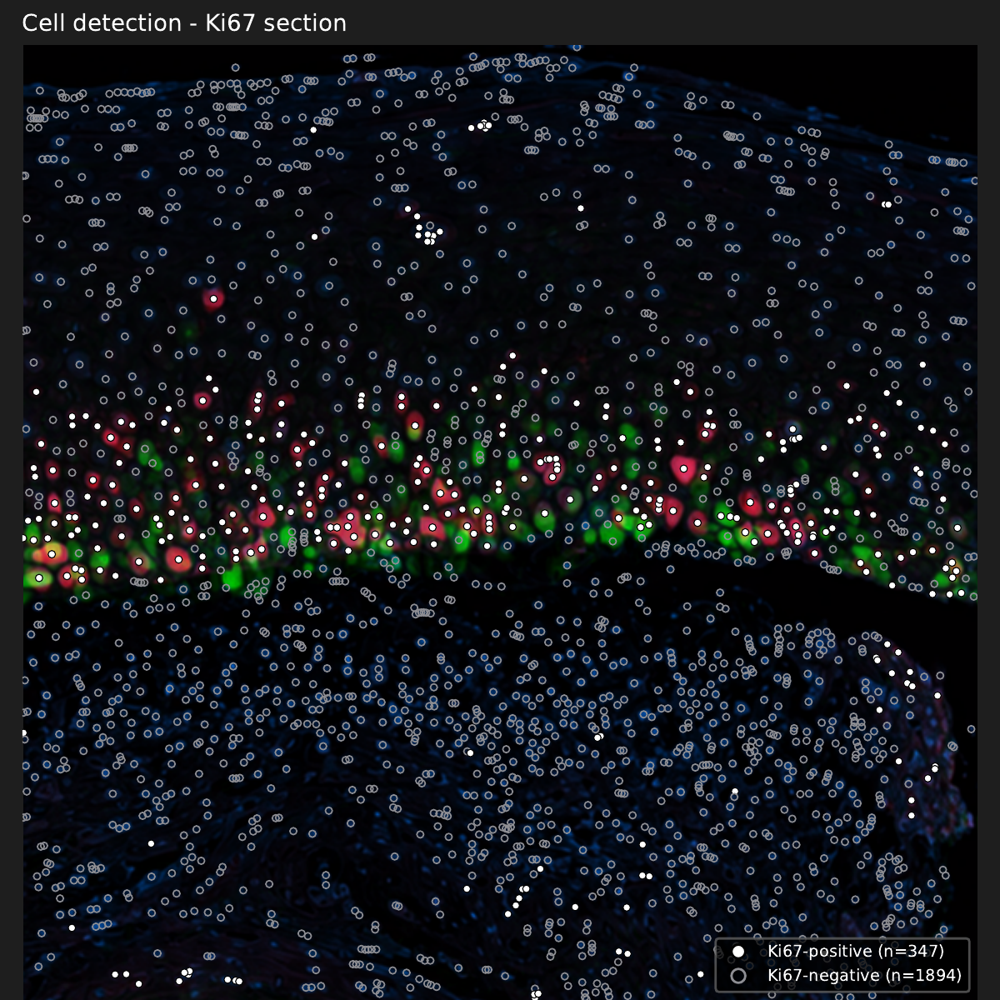
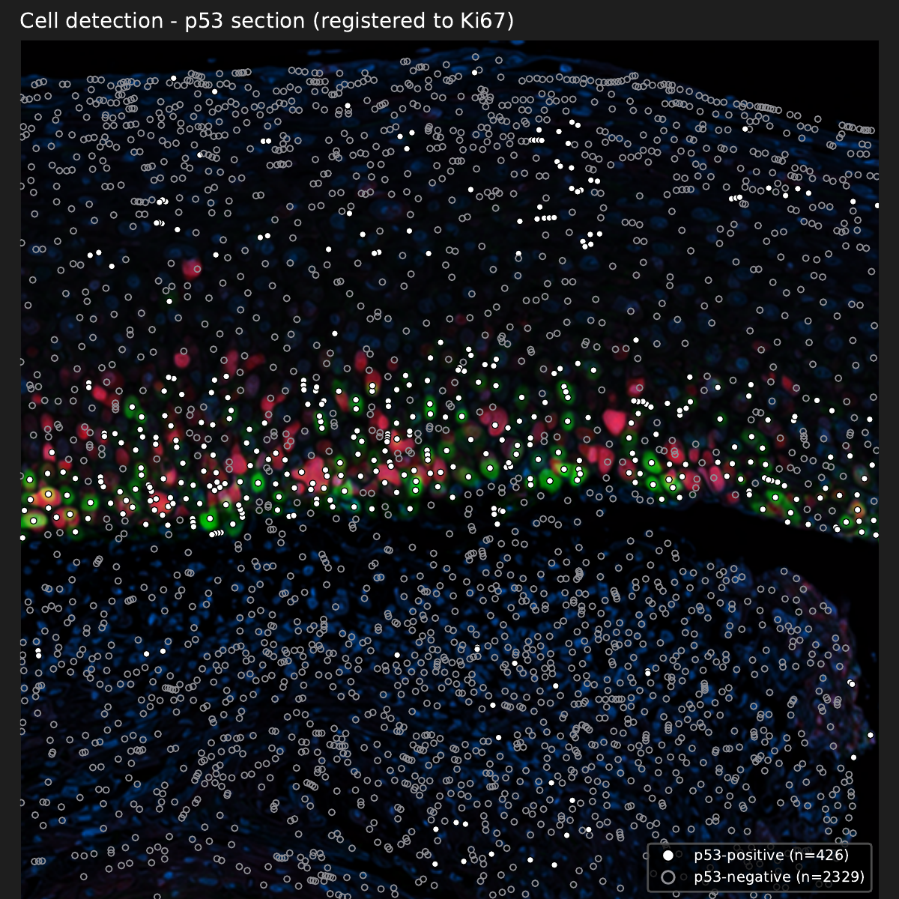

# Virtual Multiplex Pathology Analyzer

A prototype desktop GUI application for **serial-section whole-slide image (WSI)** analysis
in pathology, including virtual multiplex fluorescence-like visualization from immunohistochemistry images. Given two consecutive sections stained for different
markers (e.g. Ki67.ndpi and p53.ndpi), it performs:

1. **Cell detection & positivity** — via the [DeepLIIF](https://deepliif.org)
   cloud API (SegRefined mask).
2. **Non-rigid image registration** — SimpleITK Rigid → Affine → B-spline.
3. **Pseudo-fluorescence visualization** — stain-deconvolution based
   (NOT DeepLIIF-generated multiplex IF).
4. **Cell-level matching + validity check** — nearest-neighbor pairing
   plus a null-model diagnostic (see "Honest limitations" below).
5. **Region-level co-localization** — tile-based Pearson/Spearman
   correlation of positive-cell densities.
6. **Export** — CSV / Excel / PNG / PDF / PPTX / JSON.

Runs on **macOS (Apple Silicon/Intel)** and **Windows 11**. GPU is not
required (the DeepLIIF cloud API handles inference).

> [!IMPORTANT]
> **About the demo images in this README**
>
> Every screenshot and analysis result shown below was produced from
> **AI-generated synthetic pathology images**. No patient specimens or
> clinical images are included anywhere in this repository. The cell
> counts and statistics shown illustrate software behaviour only and do
> **not** represent diagnostic performance.


## ⚠ Important notices

- **Research and education use only. Not for clinical diagnosis.**
- **Research use; selling is not permitted.** This project is licensed
  under Apache 2.0 with the Commons Clause condition, which prohibits
  selling the software, or a product or service whose value derives
  entirely or substantially from its functionality (see `LICENSE`).
  DeepLIIF itself is made available for non-commercial academic
  purposes, so analyses that rely on the DeepLIIF cloud API should be
  treated as non-commercial academic use as well.
- This project is an independent personal software project developed by the author. It is not an official product of the author's employer. Bug reports and issues are handled on a best-effort basis.
- **Do not upload PHI/PII** (patient-identifying whole-slide images) to
  the DeepLIIF public endpoint. Use anonymized or public sample data.

## Honest limitations (please read before publishing results)

Several aspects of this workflow are known to be imperfect and are
surfaced in the output rather than hidden:

- **The DeepLIIF cloud API returns only segmentation outputs**
  (`Seg`, `SegOverlaid`, `SegRefined`) — it does **not** return the
  Virtual DAPI / Marker / Lap2 modality images that DeepLIIF is known
  for. Those require local (GPU) execution of DeepLIIF, which this
  project does not perform. Consequently:
  - Cell detection and positive/negative classification **are** from
    DeepLIIF (SegRefined).
  - The colored "fluorescence-like" display and the "Pseudo DAPI"
    channel are **stain-deconvolution outputs of the original IHC**
    (Ruifrok–Johnston), not DeepLIIF Virtual IF.
- **Serial sections do not preserve 1:1 cell correspondence.** A Ki67
  nucleus and a p53 nucleus that lie a few micrometers apart across
  adjacent sections are typically **different cells**. This project
  therefore always computes a null-model diagnostic (`match_diagnostics`):
  the observed nearest-neighbor distance distribution is compared with
  the distribution under a random-placement null. If the two are not
  distinguishable, the "co-positive rate" is flagged as not being
  evidence of same-cell co-expression.
- **A positive separation score is not proof of cell-level
  correspondence.** The null model places points uniformly at random
  within the ROI. When the ROI contains regions of very different cell
  density — epithelium next to stroma, for example — nearest-neighbor
  distances in the dense region are necessarily shorter than under a
  uniform null, so separation can be positive merely because the two
  sections share a density gradient. Read the threshold-sensitivity plot
  alongside it (see the demo below for a worked example).
- **Region-level co-localization** (tile-based density correlation) is
  the recommended primary readout for serial-section IHC pairs.

## Related work

Registering serial sections and combining them into a virtual multiplex
image is an established technique, and this project does not claim
methodological novelty. If your main need is accurate registration of
many slides, the tools below are more mature and are recommended:

- **VALIS** — Python tool that registers brightfield and/or
  immunofluorescence whole-slide images, including multi-gigapixel
  slides, and writes the aligned, multiplexed result as OME-TIFF.
  Gatenbee CD *et al.* Virtual alignment of pathology image series for
  multi-gigapixel whole slide images. *Nat Commun* 14, 2023.
  [doi:10.1038/s41467-023-40218-9](https://doi.org/10.1038/s41467-023-40218-9) ·
  <https://github.com/MathOnco/valis>
- **Warpy** — links QuPath, Fiji and elastix so that whole-slide images
  can be aligned (with manual correction via BigWarp) and regions of
  interest transferred between slides in QuPath.
  Chiaruttini N *et al.* An open-source whole slide image registration
  workflow at cellular precision using Fiji, QuPath and Elastix.
  *Front Comput Sci* 3:780026, 2022.
  [doi:10.3389/fcomp.2021.780026](https://doi.org/10.3389/fcomp.2021.780026)
- **Hyper-Stain Inspector** — two-stage registration of serial
  histology whole-slide images followed by localised co-expression
  analysis across differently stained sections, the closest in aim to
  this project.
  Trahearn N *et al.* *Sci Rep* 7:5641, 2017.
  [doi:10.1038/s41598-017-05511-w](https://doi.org/10.1038/s41598-017-05511-w)

What this project adds is narrower: a no-code GUI that runs without a
local GPU (via the DeepLIIF cloud API), and an output that always reports
whether cell-level matching is distinguishable from chance alongside the
region-level readout.

Like any serial-section approach, it cannot establish co-localization
**within a nucleus** — for example, the relationship between nuclear
foci of two proteins. Adjacent sections a few micrometers apart show
different parts of a nucleus, or different nuclei altogether.
Sub-nuclear co-localization requires multiplex staining of the same
section.

## Screenshots

The following walkthrough uses an AI-generated synthetic Ki67 / p53 pair
(see "Sample data" below for how it was produced).

**Analysis settings used:** DeepLIIF cloud API at 40x, ROI 2000 × 2000 px
(600 × 600 µm) placed at the same coordinates on both sections,
registration `rigid+affine+bspline`, matching distance 10.00 µm.

### 1. Main window


Four-pane layout: WSI list (left), viewer (center), analysis settings
(right), and a log pane at the bottom (cropped out of these screenshots).
Dimensions and mpp of each loaded slide are shown in the list.

*Input is an AI-generated synthetic image, not patient data.*

### 2. ROI selection


Click to place a fixed-size ROI using the `2000×2000` preset, with a
cursor-following preview. Place the ROI at the **same coordinates** on
both sections — otherwise registration ends up correcting your click
error rather than the actual tissue deformation, and the overlapping
area shrinks.

*Input is an AI-generated synthetic image, not patient data.*

### 3. Pseudo-fluorescence merge


Ki67 (red) and p53 (green) overlaid on a hematoxylin-derived Pseudo DAPI
channel (blue). The band of positive nuclei along the basal layer
contrasts with the negative stroma below.

As noted above, this display is stain-deconvolution based — it is not
DeepLIIF Virtual IF.

*Input is an AI-generated synthetic image, not patient data.*

### 4. Cell detection overlays (one per section)

| Ki67 section (fixed image) | p53 section (registered to Ki67) |
|---|---|
|  |  |

Nuclei obtained by watershed splitting of the DeepLIIF `SegRefined` mask,
drawn separately for each section. Each figure states which section it
shows, and its legend gives the positive / negative counts for that
marker: **filled white = positive, gray ring = negative**.

The dots are deliberately colorless. The background is the
pseudo-fluorescence merge, whose channels are colored (Ki67 red, p53
green, nuclei blue), so colored dots would be easy to misread as channel
signal. The Ki67 section is the fixed image in registration, so its
coordinates are the original ones; the p53 cells are shown after warping
into the Ki67 frame.

The report also includes a nucleus-density heatmap for the Ki67 section.
It counts **all detected nuclei**, positive and negative alike — it is
not a positive-cell density map.

*Input is an AI-generated synthetic image, not patient data.*

### 5. Cell matching validity


| Metric | Value |
|---|---|
| Matched cell pairs | 1298 (match rate 57.9%) |
| Median nearest-neighbor distance, observed | 4.65 µm |
| Median nearest-neighbor distance, random null | 5.34 µm |
| Separation | 0.129 |
| Verdict | **Not distinguishable from chance** |

For this field the app concludes that cell-level matching is **not
distinguishable from chance**, and therefore that the co-positive rate is
not evidence of same-cell co-expression. That is the correct answer: the
two synthetic images were generated independently and have no cell-level
correspondence by construction.

The threshold-sensitivity panel on the right supports the same reading.
If co-positivity reflected genuine same-cell co-expression, tightening
the matching threshold should *raise* the co-positive rate. Instead it
stays **flat at about 0.06–0.08 across thresholds from 1 to 15 µm**
(slightly lower at the tightest thresholds; the 1 µm point rests on only
70 pairs, so treat it as noisy).

Note also that separation is still positive (0.129) even though there is
no correspondence. This is the density-gradient effect described under
"Honest limitations": the observed distribution is shifted toward shorter
distances simply because both sections have a dense epithelium and a
sparser stroma.

*Input is an AI-generated synthetic image, not patient data.*

### 6. Region-level co-localization


Positive-cell density is computed per 100 µm tile and correlated between
the two markers. This is the recommended primary readout.

| Metric | Value |
|---|---|
| Pearson r (n = 36 tiles) | 0.807 |
| Spearman ρ (n = 36 tiles) | 0.729 |
| Ki67+ index (matched cells) | 0.164 |
| p53+ index (matched cells) | 0.183 |
| Co-positive overlap (Jaccard) | 0.297 |

Both heatmaps place the positive cells in the same horizontal band — the
basal layer — and the scatter plot reflects that shared layout.

Both coefficients are reported deliberately. Most tiles fall in a cluster
of low densities near the origin, and a handful of basal-layer tiles sit
further out, so Pearson is sensitive to those few points. **Read the
rank-based Spearman ρ = 0.729 as the more conservative figure.**

*Input is an AI-generated synthetic image, not patient data. These
numbers are for demonstration and do not represent diagnostic
performance.*

### 7. Results and export


The summary dialog reports matched cell count, positivity indices,
matching validity, and region-level correlation. Results can be exported
as CSV / Excel / PNG / PDF / PPTX / JSON.

*Input is an AI-generated synthetic image, not patient data.*

## Sample data (no patient data is bundled)

### Synthetic demo pair (used for the screenshots above)

The Ki67 / p53 images used throughout this README were generated by an
image-generation AI and contain no patient information. `tools/make_demo_wsi.py`
converts such a pair into pyramidal TIFFs that the app can open as WSIs:

```bash
python tools/make_demo_wsi.py \
    --ki67 "docs/demo_source/Ki67_demo.png" \
    --p53  "docs/demo_source/p53_demo.png" \
    --outdir demo_data --scale 4 --mpp 0.30
```

This upsamples 4× and writes tiled, pyramidal TIFFs (6148 × 4092 px,
mpp 0.30 µm/px, 512 px tiles) with the resolution embedded in the TIFF
tags. Pass `--watermark` to burn a `SYNTHETIC IMAGE - NOT PATIENT DATA`
watermark across the image.

<details>
<summary>Why upsample 4×?</summary>

The source images have a nuclear equivalent diameter of roughly 5 px,
which corresponds to about 10x. DeepLIIF is trained at 40x with 512 px
tiles, and handles 10x input by taking 128 px tiles and enlarging them
4× internally. Doing that enlargement up front changes nothing
substantive about the processing, and it lets the WSI-oriented features
(pyramid navigation, ROI presets, tiling) be exercised as they would be
on a real slide.

</details>

### Public datasets

- **DeepLIIF sample tissues** (Nadeem Lab): Ki67 IHC patches for testing
  the cloud API — <https://github.com/nadeemlab/DeepLIIF>
- **OpenSlide demo WSIs**: NDPI/SVS files for testing the WSI loader —
  <https://openslide.org/demo/>
- **Human Protein Atlas** (CC BY-SA 4.0): IHC images for Ki67, p53, etc.
  — <https://www.proteinatlas.org/>

The repository also contains a self-contained synthetic test in
`tests/smoke_pipeline.py` that runs without any external data.

## Requirements

- Python 3.11+
- OpenSlide native library (for `.ndpi` and other WSI formats)

## Installation

```bash
# Clone
git clone https://github.com/Takamoto36/VirtualMultiplexAnalyzer.git
cd VirtualMultiplexAnalyzer

# Create a virtual environment
python3 -m venv .venv
source .venv/bin/activate            # macOS/Linux
# .venv\Scripts\Activate.ps1         # Windows PowerShell

# Install dependencies
pip install --upgrade pip
pip install -r requirements.txt

# Native library for .ndpi
brew install openslide               # macOS
# See https://openslide.org/download/ for Windows binaries.
```

## Run

```bash
python app.py
```

## Basic workflow

1. Click "+ WSI を追加" and load two serial sections (e.g. Ki67.ndpi
   and p53.ndpi).
2. Switch to "ROI 選択モード" (default on). Click on the tissue with
   the `2000×2000` preset to place a fixed-size ROI on each section,
   targeting the **same anatomical region** on both.
3. Set the resolution to match the slide's mpp. DeepLIIF selects its
   tile size from this (40x → 512, 20x → 256, 10x → 128), so a mismatch
   degrades detection.
4. Click "▶ 解析を実行". Analysis takes a few minutes.
5. Read the results dialog carefully — the "Cell Matching 妥当性"
   line tells you whether the cell-level correspondence is
   distinguishable from chance for this field of view.
6. Export via File → Export.

> [!NOTE]
> The DeepLIIF cloud endpoint accepts images up to 4096 × 4096 px and
> times out after roughly one minute per request. Large ROIs may return
> a 504; if that happens, use a smaller ROI.

## Tests

```bash
pytest -q
```

All tests should pass without any external services (the API-facing
tests are mocked).

## Citation

If you use this software in academic work, please cite the underlying
DeepLIIF papers (see `THIRD_PARTY_LICENSES.md`). Citation of this
project itself is optional; a `CITATION.cff` may be added later.

## License

Apache License 2.0 with the Commons Clause condition — see `LICENSE`.
Third-party dependencies retain their original licenses; see
`THIRD_PARTY_LICENSES.md`.

## Disclaimer

THIS SOFTWARE IS PROVIDED "AS IS", WITHOUT WARRANTY OF ANY KIND. It is
not a medical device and must not be used for clinical decision-making.
The developer is not liable for any use of, or reliance on, its output.
